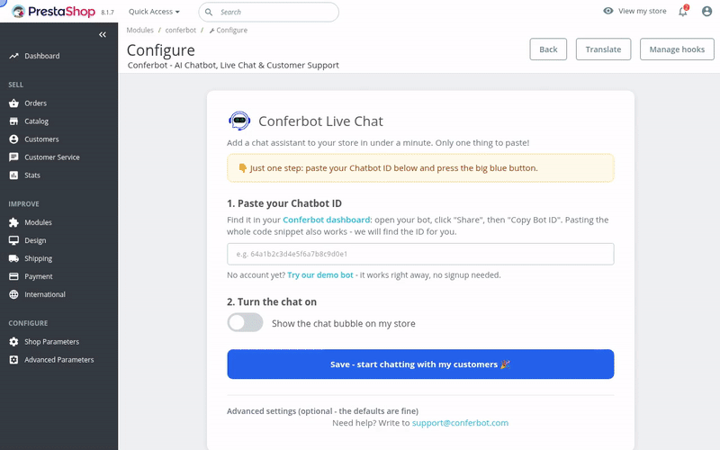

# Conferbot PrestaShop Module

Embeds the [Conferbot](https://conferbot.com) AI chat widget on a PrestaShop store and passes the logged-in customer identity plus store/cart context to the bot.

## See it in action

Paste the Chatbot ID, flip the switch, and the bot is live on the storefront - 30 seconds end to end:



[HD video (MP4)](docs/demo.mp4) - also attached to the [latest release](https://github.com/Conferbot/conferbot-prestashop/releases).

## How it works

The module hooks `displayHeader` and injects the standard Conferbot loader. The widget script loads without blocking the page, and `ConferbotWidget` is called once it has loaded:

```html
<script>
  (function (d, s, id) {
    var js = d.createElement(s); js.async = true; js.id = id;
    js.src = "https://cdn.conferbot.com/dist/v1/widget.min.js";
    d.head.appendChild(js);
    js.onload = function () {
      window.ConferbotWidget("<CHATBOT_ID>", "live_chat", {
        user:       { id: "ps-42", name, email, hash },   // logged-in customer, if any
        customData: { platform: "prestashop", storeName, storeUrl,
                      storeLanguage, storeCurrency, cartTotal, cartItemCount }
      });
      // On the order confirmation page, once per order:
      window.ConferbotWidget.track("purchase", { value, currency, order_id });
    };
  })(document, "script", "conferbot-js");
</script>
```

The only credential needed is the **Chatbot ID**. Everything visitors see is set per bot in the Conferbot dashboard and delivered at runtime, with nothing to configure in PrestaShop: flows and AI agents, live chat with handover to your team (queue position, leave a message when nobody is free, read receipts, file sharing, post-chat rating), the home screen, themes and dark mode, colours, launcher and mascot, greetings, languages and disabled URLs. The module does not duplicate those settings.

### Identity verification (optional)

With a secret from Conferbot (workspace settings > Security > Identity verification) pasted under Advanced settings, each logged-in customer is sent with `hash = HMAC-SHA256(secret, user.id)`, computed on your server. Conferbot then trusts their name and email and can link their chats to their contact. The secret is stored in your PrestaShop configuration and never sent to the browser. Without it, the customer's details are still passed but marked unverified, and if your workspace *requires* verification they are dropped.

### Sales tracking

The order confirmation page reports the customer's own order (`purchase`, with value, currency and order reference) once per order, and every cart change is reported as `cart_updated`. Conferbot credits a sale to a chat that happened within the week before it.

`options.user` and `options.customData` become the visitor's identity/context in Conferbot chats, so the bot and human agents see the customer's name, email, cart total, and store details.

## Requirements

- PrestaShop 1.7 or 8.x (verified on 8.2)
- PHP 7.2+
- A Conferbot account with a published chatbot (or use the built-in demo bot to try it first)

## Installation

1. Zip the module folder as `conferbot.zip` (the zip must contain a top-level `conferbot/` directory).
2. In the PrestaShop admin, go to **Modules > Module Manager > Upload a module** and upload the zip.
   (Or copy the folder to `/modules/conferbot/` and install from Module Manager. CLI: `bin/console prestashop:module install conferbot`.)
3. Click **Configure**.

## Configuration

The configure screen is two steps: paste your Chatbot ID, flip the switch, save. You can paste the bare ID, the full embed snippet, or a dashboard URL - the module extracts the ID for you.

**No account yet?** Click "Try our demo bot" on the configure screen. It fills in the public demo bot (`691c970890527a0468f9b2c9`), which works out of the box so you can see the widget live before signing up.

| Setting | Description |
|---|---|
| Chatbot ID | Required. In the Conferbot dashboard open your bot, go to **Share > Embed**, and copy the embed code; the module finds the 24-character ID in it. |
| Turn the chat on | Master on/off switch. |
| How the chat appears | Floating chat bubble (default) or popup window. *(Advanced)* |
| Show on these pages | Per-page-type visibility: home, category/search, product, cart, checkout, customer account, all other pages. *(Advanced)* |
| Identity verification secret | Optional. Signs logged-in customers so Conferbot can trust them. Write-only: shown as saved, never displayed. *(Advanced)* |
| Widget script URL | Leave as is for the Conferbot CDN. Useful for staging/self-hosted widget builds. *(Advanced)* |

## Architecture

The module class only wires PrestaShop hooks and the configure screen; the logic lives in small, individually tested classes:

```
modules/conferbot/
├── conferbot.php                        # Module: hooks + configure screen wiring
├── classes/
│   ├── ConferbotBotId.php               # Bot ID extraction/validation + demo bot ID
│   ├── ConferbotPageResolver.php        # Controller -> page type map + visibility rules
│   ├── ConferbotWidgetContext.php       # Builds ConferbotWidget() options + safe JSON
│   └── ConferbotSettings.php            # Configuration keys, defaults, persistence
├── upgrade/upgrade-1.3.0.php            # In-place upgrade: legacy keys out, storefront hook in
├── views/templates/
│   ├── admin/configure.tpl              # Two-step configure UI
│   └── hook/displayHeader.tpl           # Widget loader snippet
├── tests/                               # PHPUnit suite (not shipped in the zip)
├── phpunit.xml
├── logo.png
├── config.xml
├── DEPLOYMENT.md                        # Packaging, install, verification
└── MARKETPLACE.md                       # PrestaShop Addons listing kit
```

Adding a setting is a one-file change in `ConferbotSettings` plus a form field in `configure.tpl`; adding a page type is one entry in `ConferbotPageResolver`.

## Tests

76 PHPUnit tests (164 assertions, PHP 7.4 and 8.2) cover bot ID parsing, controller-to-page-type mapping, visibility rules, widget option building (guest/customer/cart variants), the identity hash and write-only secret, purchase events, script-injection safety of the inlined JSON, and settings persistence including legacy-key cleanup. The suite runs without a PrestaShop installation - `tests/bootstrap.php` stubs `Configuration`.

```bash
# any PHP 7.2+ with phpunit 9:
phpunit

# or containerized:
docker run --rm -v "$PWD":/mod -v /path/to/phpunit-9.phar:/phpunit.phar:ro \
  -w /mod php:8.2-cli php /phpunit.phar
```

## Manual verification

1. Save the configuration with a valid Chatbot ID (or the demo bot).
2. Open the storefront - the chat bubble should appear (subject to the bot's own dashboard settings such as disabled URLs and load delay).
3. Log in as a customer and start a chat: the conversation in the Conferbot inbox should show the customer's name/email and cart context (marked verified when the identity secret is set).
4. Place an order: the order confirmation page reports the purchase once.

## Notes & limitations

- No API key or workspace ID is required - the widget resolves everything server-side from the Chatbot ID over Socket.IO (`wdt.conferbot.com`).
- Outbound webhooks (order status, product updates, abandoned cart) are **not** part of this version; the Conferbot backend does not yet expose PrestaShop webhook endpoints. See `server/docs/integrations/prestashop-integration-guide.md` for the roadmap.
- If the widget does not appear: check the module is enabled, the Chatbot ID is correct and the bot is published/not disabled, the current page type is enabled in **Show on these pages**, and clear the PrestaShop cache (**Advanced Parameters > Performance > Clear cache**).

## License

Academic Free License (AFL 3.0).
